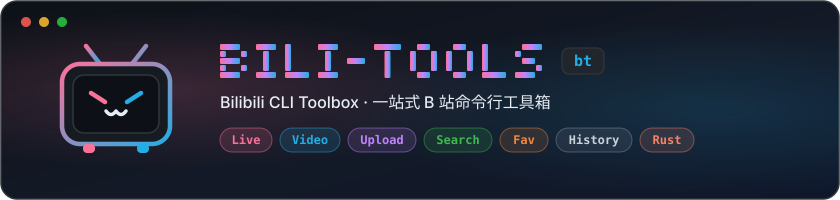
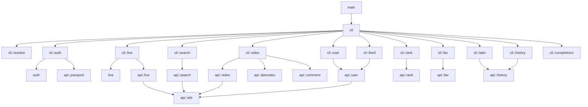

# bili-tools (`bt`)

<p align="center">
  
</p>

B站终端多功能工具箱，提供开播下播、账号管理、视频检索、个人数据（收藏夹/历史/稍后再看）等丰富命令行功能。

## 安装

### Cargo (通用)

```bash
# 首次需安装 Rust 工具链
curl --proto '=https' --tlsv1.2 -sSf https://sh.rustup.rs | sh

# 克隆并编译安装
git clone https://github.com/QwerProg/bili-tools.git --depth=1
cd bili-tools
cargo install --path .
```

编译安装到 `~/.cargo/bin/bt`，确认该目录在 PATH 中即可。

### macOS (Homebrew)

```bash
brew install QwerProg/bili-tools/bt
```

### Arch Linux (AUR)

```bash
# 使用 yay
yay -S bili-tools-bin

# 或使用 paru
paru -S bili-tools-bin
```

### Windows

#### Winget
```bash
winget install QwerProg.bt
```

#### Scoop

```powershell
# 安装 Scoop
Set-ExecutionPolicy -ExecutionPolicy RemoteSigned -Scope CurrentUser
Invoke-RestMethod -Uri https://get.scoop.sh | Invoke-Expression

# 添加 bucket
scoop bucket add QwerProg https://github.com/QwerProg/bili-tools

# 安装
scoop install bt

# 日后升级
scoop update bt
```

#### 手动下载
从 [Releases](https://github.com/QwerProg/bili-tools/releases) 下载 `bt-x86_64-windows.zip`，解压后即可运行。

## 快速使用

```bash
# 通用标识解析
bt resolve https://b23.tv/pigt3PQ          # 展开 b23.tv 短链接并解析目标 ID
bt resolve "https://www.bilibili.com/video/BV1hp4y1k7SV?p=2" --no-network

# 账号管理
bt auth login                              # 交互选择登录方式 (Web/TV扫码, 短信, 密码, Cookie)
bt auth login --method cookie --sessdata <S> --bili-jct <J>
bt auth status                             # 查看登录状态、UID、硬币、会员到期等
bt auth daily                              # 查询每日经验奖励并执行直播签到
bt auth refresh                            # 刷新持久化 Cookie
bt auth logout                             # 退出登录并清除凭证

# 直播模块
bt live start                              # 交互式开播
bt live start -a 398 -t "标题"              # 指定分区与标题直接开播
bt live stop                               # 立即下播
bt live stop -d 30m                        # 30分钟后下播（Ctrl+C 取消）
bt live status                             # 查看自己直播间实时状态
bt live info 76                            # 查看任意直播间详情（支持短号/URL）
bt live following                          # 查看已关注主播的开播情况
bt live title "新标题"                      # 修改直播间标题
bt live area "游戏"                         # 搜索或列出直播分区
bt live stream 76 -Q 10000                 # 获取直播间拉流地址（-Q 指定画质）
bt live danmaku 76 --limit 20              # 查看直播间近期弹幕快照
bt live danmaku 76 -f                      # 持续监听直播间实时弹幕流（配合 --json 输出 NDJSON）
bt live chat                               # 打开看发一体的终端实时弹幕聊天室 TUI（默认进自己直播间）
bt live chat 76 --no-enter                 # 进入指定直播间聊天室并初始隐藏进房提示
bt live send 76 "主播好"                    # 向直播间发送弹幕
bt live record 76 -o live.flv -Q 400 -d 5m # 录制直播流（需要 ffmpeg）
bt live record 76 --danmaku -w -o live.flv # 24/7 守候录制并同步保存 .ass 弹幕
bt -D live start -a 372 -s                 # 国内直连模式开播（绕过本机代理/TUN，输出 OBS 免代理地址）

# 搜索发现
bt search hot --limit 20                   # 查看实时热搜榜
bt search video "Rust" --order click       # 搜索视频（WBI 签名加密鉴权）
bt search user "老番茄" --order fans        # 搜索 UP 主
bt search live "自习室"                     # 搜索直播间

# 视频查询、下载与互动
bt video info BV1hp4y1k7SV                 # 查看视频详情（播放/弹幕/分P列表）
bt video streams BV1hp4y1k7SV -p 1         # 查看可用清晰度、编码与流地址
bt video subtitle BV1hp4y1k7SV --format srt -o sub.srt
bt video summary BV1hp4y1k7SV              # 查看视频 AI 总结与大纲
bt video tags BV1hp4y1k7SV                 # 查看视频标签
bt video related BV1hp4y1k7SV              # 查看相关推荐视频
bt video danmaku BV1hp4y1k7SV --format ass -o dm.ass
bt video comments BV1hp4y1k7SV --sort hot  # 查看评论列表（加 --root <RPID> 看楼中楼，--full 看完整多行）
bt video comment post BV1hp4y1k7SV "好评"   # 发表/点赞/删除评论 (post/like/delete)
bt video like BV1hp4y1k7SV                 # 点赞
bt video coin BV1hp4y1k7SV -n 2            # 投币 (1-2)
bt video triple BV1hp4y1k7SV               # 一键三连
bt video download BV1hp4y1k7SV -p 1 -Q 80 -e hevc --danmaku --subtitle --cover
bt video upload a.mp4 --title "演示" --tid 171 --tag "工具,CLI" # UPOS 投稿（支持多 P / --line）
bt video append <BVID> b.mp4               # 向已有稿件追加分 P
bt video studio ls                         # 查看创作中心个人稿件列表

# 用户主页、动态与榜单
bt user info https://space.bilibili.com/293793435
bt user videos 293793435 --order click --page-size 10
bt user dynamics 293793435
bt user follow 293793435                   # 关注 UP 主
bt user unfollow 293793435                 # 取消关注
bt feed --type video                       # 查看已关注 UP 主动态流
bt rank video --rid 0 --type all           # 全站/分区视频排行榜
bt rank popular --page 1 --page-size 20    # 综合热门视频

# 个人数据
bt fav list                                # 列出所有收藏夹
bt fav show <收藏夹ID>                      # 查看指定收藏夹内容
bt fav export <ID> --format csv -o fav.csv # 导出收藏夹（支持 json/csv/text）
bt fav add <收藏夹ID> BV1hp4y1k7SV          # 添加视频到收藏夹
bt fav remove <收藏夹ID> BV1hp4y1k7SV       # 从收藏夹移除视频
bt fav clean <收藏夹ID> -y                  # 清理失效视频
bt fav create "新建收藏夹" --private         # 创建收藏夹
bt fav delete <收藏夹ID> -y                 # 删除收藏夹
bt later list                              # 查看稍后再看列表
bt later add BV1hp4y1k7SV                  # 添加到稍后再看
bt later remove BV1hp4y1k7SV               # 从稍后再看移除
bt later clear --viewed-only -y            # 清理已看完视频
bt history list --limit 10 -c archive      # 查看观看历史（-c: all/archive/live/article）
bt history delete BV1hp4y1k7SV             # 删除单条历史记录
bt history clear -y                        # 清空观看历史

# 全局选项与多账号隔离
bt --json search hot                       # 机器可读 JSON 输出（成功与失败均为 JSON）
bt -q live status                          # 静默模式，抑制提示与装饰输出
bt --no-color rank popular                 # 禁用 ANSI 彩色输出
bt -u /tmp/alt.json auth status            # 指定自定义 Cookie 文件路径

# Shell 补全
bt completions --install                   # 自动识别当前 Shell 并安装补全（也支持指定 bash/zsh/fish/powershell/elvish）
```

### 命令架构

```
Usage: bt [OPTIONS] [COMMAND]

Commands:
  resolve      通用 B站 ID、URL 或 b23.tv 短链接解析
  auth         账号与认证管理 (login, status, logout, refresh, daily)
  live         直播间管理、拉流、聊天与录制 (start, stop, status, info, title, area, following, stream, danmaku, chat, send, record)
  search       内容与用户搜索 (video, user, live, hot)
  video        视频操作、下载与投稿 (info, streams, subtitle, summary, tags, related, danmaku, comments, comment, like, coin, triple, download, upload, append, studio)
  user         用户主页、投稿与关系管理 (info, videos, dynamics, follow, unfollow)
  feed         查看已关注 UP 主动态流
  rank         全站视频排行榜与综合热门 (video, popular)
  fav          收藏夹管理与导出 (list, show, export, add, remove, clean, create, delete)
  later        稍后再看管理 (list, add, remove, clear)
  history      观看历史记录管理 (list, delete, clear)
  completions  生成 shell 自动补全脚本 (bash, zsh, fish, powershell, elvish)

Options:
      --json                以 JSON 格式输出结果（含结构化错误信封）
  -q, --quiet               静默模式，不输出装饰与提示信息
  -v, --verbose             输出详细调试日志 (-v/-vv/-vvv，等价于 RUST_LOG)
  -y, --yes                 自动确认交互式或危险操作
      --no-color            禁用终端彩色输出 (等价于 NO_COLOR=1)
  -D, --direct              国内直连模式（公共 DoH + 原生 IPv6 绕过代理/TUN 虚拟网卡）
  -u, --cookie-file <PATH>  指定自定义 Cookie 文件路径
  -h, --help                显示帮助
  -V, --version             显示版本号
```

> 补充说明：`bt video comment` 包含三级子命令 `post` / `like` / `delete`；画质参数统一使用 `-Q, --quality`（避免与全局 `-q, --quiet` 冲突）；`history list` 分类过滤使用 `-c, --category`（`all` / `archive` / `live` / `article`）。
>
> 常用默认参数与扩展选项：`video download` 默认 `-Q 120`、`-e avc`，`-o` 支持 `{title}`、`{bvid}`、`{aid}`、`{p}`、`{page}`、`{p_title}`、`{part}`、`{quality}`、`{codec}` 模板变量；`video danmaku` 默认 `--format xml`；`video subtitle` 默认 `--format srt` 并支持 `--lang <CODE>`；`video comments` 默认 `--sort hot`；`video comment post` 支持 `--root` / `--parent` 回复指定评论，`video comment like` 支持 `--cancel`；`user videos` 支持 `--keyword` 筛选，`user dynamics` 与 `feed` 均支持 `--offset <CURSOR>` 游标翻页。

### 外部依赖边界 (`ffmpeg`)

- **纯 CLI / API 命令零外部依赖**：`resolve`、`auth`、`search`、`user`、`feed`、`rank`、`fav`、`later`、`history`、`completions` 以及所有元信息/字幕/弹幕/评论/流查询命令均完全自包含，无需任何外部二进制即可运行。
- **按需调用 `ffmpeg`**：仅 `bt video download`（在需要 DASH 音视频混流时；若传入 `--audio-only`、`--video-only` 或 `--skip-mux` 则无需 `ffmpeg`）与 `bt live record` 会探测系统 `PATH`（或环境变量 `BT_FFMPEG_PATH`）中的 `ffmpeg`。若未安装 `ffmpeg`，程序会在执行前清洁报错并给出安装指引，绝不会 panic。

## CLI 设计审计与重构对比

本次重构对照 `biliup` / `biliup-rs`、`BBDown`、`yutto` 与 `bilibili-cli` 等主流 B 站 CLI 项目，对初代 `bt` CLI 的结构、参数一致性、安全边界与脚本自动化能力进行了全面审计与重构：

| 原版 `bt` CLI 缺陷 | 参考项目设计借鉴 | 重构落地方案 |
|---|---|---|
| 顶层命令扁平混杂（`start`/`stop`/`status` 与 `auth`/`fav` 等同级），命名不统一 | 借鉴 `biliup-rs` / `bilibili-cli` 领域分组子命令树（`<domain> <verb>`） | 收敛为 12 个语义清晰的顶层域命令（`live start\|stop\|status\|...`、`auth`、`video`、`user`、`feed`、`rank`、`fav`、`later`、`history`、`search`、`resolve`、`completions`） |
| `live start -y` 在已开播状态下存在误触发关播或重复开播风险 | 参考 `biliup` 幂等直播状态管理 | 开播前校验 `live_status`，已开播时安全返回 `already_live: true` 与提示，绝不意外调用 `stopLive` |
| `live stop -d` 先睡眠等待倒计时再校验登录/开播状态，失效时浪费等待时间 | 参考工程化 CLI 前置校验模式 | 在进入倒计时前先解析时长并校验登录态、房间绑定与直播状态，未开播直接返回 |
| `live title` / `live area` 同时存在位置参数与多余短选项冲突 | 参考 `bilibili-cli` 单一清晰位置参数 | 统一收敛为单位置参数 `live title <TITLE>` 与 `live area [KEYWORD]`，并拒绝纯空白标题 |
| 全局 `-q/--quiet` 与画质 `-q`、类型 `-t` 存在参数冲突 | 参考 `BBDown` / `yutto` 区分全局输出选项与媒体质量参数 | 全局保留 `-q/--quiet`，画质统一为 `-Q/--quality`；`history list` 分类改为 `-c/--category` |
| 搜索排序、导出格式、历史分类等选项使用裸字符串，非法值延迟到 API 才失败 | 参考现代 Rust CLI 强类型参数校验 | 全部枚举参数改用 `clap::ValueEnum`（`search --order`、`fav export --format`、`history list -c`、`video comments --sort`、`video download -e`、`feed --type`、`rank video --type`）与范围校验 |
| 仅支持裸 BV/AV/房间号，无法直接粘贴 B 站网页 URL、`?p=N`、`b23.tv` 短链或番剧/空间/收藏夹链接 | 借鉴 `BBDown` 与 `yutto` 的通用资源解析器 | 新增 `src/utils/id.rs` 与 `bt resolve <INPUT>`，统一解析 `BV`/`av`/`ep`/`ss`/`md`/完整 URL/`?p=N`/`space`/`favlist`/`live` 及 `b23.tv` 重定向（支持 `--no-network`） |
| 缺乏视频深层检索、弹幕/字幕/AI 总结、评论互动与多清晰度下载能力 | 借鉴 `BBDown`（DASH 流选择/混流、多 P 选择、命名模板）与 `yutto`（弹幕 ASS/字幕/封面 sidecar） | 新增完整 `bt video` 命令族（`info`/`streams`/`subtitle`/`summary`/`tags`/`related`/`danmaku`/`comments`/`comment`/`like`/`coin`/`triple`/`download`），纯 Rust `flate2` 解压弹幕并导出 ASS/TXT/JSON |
| 缺乏 UP 主主页、关注动态时间线、排行榜与每日经验/直播签到 | 借鉴 `bilibili-cli` 个人动态/榜单流与 `biliup` 账号任务 | 新增 `bt user`、`bt feed`、`bt rank` 与 `bt auth daily`，并支持 `--method` 非交互登录与 `auth refresh` |
| stdout/stderr 混杂、错误仅打印文本、多账号需手动替换默认配置 | 借鉴自动化 CLI 契约设计 | 严格分离 `stdout`（JSON/表格/导出）与 `stderr`（状态/进度/日志）；全局 `--json` 统一覆盖成功与错误信封；支持 `-q`、`-y`、`--no-color`（遵循 `NO_COLOR` 规范）及 `-u/--cookie-file` 多账号隔离 |
| 媒体混流与录制缺少明确外部工具边界，缺失依赖易产生晦涩报错 | 参考 `BBDown` / `yutto` 对 `ffmpeg` 的清晰边界划分 | 独立 `src/utils/ffmpeg.rs` 在执行前探针检测并给出可操作错误提示（支持 `BT_FFMPEG_PATH`），纯 CLI/API 命令零外部二进制依赖 |

## 交互流程

```
# 首次使用 — 扫码登录
bt auth login
✔ 选择一种登录方式 · 扫码登录（Web，推荐）
  ℹ 开始B站Web二维码登录流程...
[终端弹出二维码]
  ✔ 二维码已保存到 ~/.config/bt/qrcode.png
  ℹ 等待用户处理...

# 登录后 — 正常开播
bt live start
  ✔ 登录状态正常
✔ 是否使用上次直播的分区？ · yes
  ✔ 使用上次的分区: 自习室 - 372
✔ 请输入新标题（回车保留原标题） · 晚上随便播会儿

  ╭─ 🎬 直播已开启 · 房间 31686846 ──────────────────────────╮
  │ 推流地址   rtmp://live-push.bilivideo.com/live-bvc/     │
  │   推流码   ?strea************...g=13  (加 -s 查看完整码) │
  │ 本地保存   ~/.config/bt/stream_info.txt                 │
  ╰───────────────────────────────────────────────────────╯

# 查看直播间状态 — 粉蓝渐变小电视 Logo + 状态与统计卡片
bt live status
```

### 登录方式

默认使用 Web 扫码登录；菜单保留 TV 扫码作为备用，也支持短信、账号密码和浏览器链接登录。扫码等待约 3 分钟后超时，二维码过期时请重新登录。所有 HTTP 请求设置 30 秒超时。

Linux/macOS 上，数据目录权限为 `0700`，Cookie 和推流信息文件为 `0600`；访问数据目录时会收紧旧版本文件的权限。凭据采用临时文件写入后替换，避免写入中断损坏原文件。

开播成功后的推流文件或统计标识保存失败、下播成功后的统计查询失败，均单独显示警告，不会将已完成的开播/下播报告为失败。

## 分区选择

使用上下箭头选择分区大类，Enter 确认后选择子分区。

## 技术栈

| 类别 | 依赖 |
|---|---|
| CLI 解析 | `clap 4`（derive 宏 + `clap_complete`） |
| HTTP 请求 | `minreq`；Web 登录轮询使用 `ureq` 保留多条 Cookie 响应头（rustls TLS） |
| 序列化 | `serde` + `serde_json` + `serde_urlencoded` |
| 压缩解码 | `flate2`（纯 Rust 后端，用于弹幕 XML raw deflate/zlib/gzip 解压） |
| 终端 UI | `dialoguer` + `crossterm` + `unicode-width` |
| 二维码与信号 | `qrcode` + `image` + `ctrlc` + `dirs` + `tempfile` |
| 日志与时间 | `log` + `env_logger` + `chrono` |
| 错误处理 | `thiserror` |
| Rust 版本 | Edition 2024 |

## 架构



```
src/
├── main.rs               # 主程序入口、顶层帮助/JSON 拦截与错误退出码映射
├── error.rs              # BiliLiveError 错误枚举与 JSON 错误码映射
├── logo.txt              # 静态 ASCII 小电视 Logo
├── cli/                  # CLI 子命令定义与终端交互
│   ├── mod.rs            # 模块导出、命令路由与 --json 元数据输出
│   ├── args.rs           # Clap 命令行定义 (12 顶层模块、ValueEnum、范围校验)
│   ├── output.rs         # 全局 --json / --quiet / --yes / --no-color / -u(--cookie-file) 状态控制
│   ├── resolve.rs        # bt resolve 通用 ID/URL 解析命令
│   ├── auth.rs           # bt auth 命令实现 (login/status/logout/refresh/daily)
│   ├── live.rs           # bt live 命令实现 (开播/下播/详情/拉流/弹幕/录制)
│   ├── search.rs         # bt search 命令实现 (视频/用户/直播/热搜)
│   ├── video.rs          # bt video 命令实现 (详情/流/字幕/总结/弹幕/评论/下载/互动)
│   ├── user.rs           # bt user 命令实现 (主页/投稿/动态/关注与取关)
│   ├── feed.rs           # bt feed 命令实现 (关注动态时间线)
│   ├── rank.rs           # bt rank 命令实现 (分区排行榜/综合热门)
│   ├── fav.rs            # bt fav 命令实现 (列表/详情/导出/增删/清理/新建删除)
│   ├── later.rs          # bt later 命令实现 (稍后再看列表/增删/清理)
│   ├── history.rs        # bt history 命令实现 (历史记录查询/删除/清空)
│   └── completions.rs    # bt completions Shell 补全
├── api/                  # 官方接口请求封装
│   ├── wbi.rs            # WBI 鉴权加密与按 base_url 隔离的密钥缓存
│   ├── client.rs         # 通用 HTTP 请求头、状态校验与 BT_*_BASE_URL 测试钩子
│   ├── area.rs           # 直播分区列表获取
│   ├── passport.rs       # 登录、Token刷新、用户信息、退出登录
│   ├── live.rs           # 直播状态、开下播、分区、拉流、弹幕
│   ├── search.rs         # 综合/视频/用户/直播搜索与热搜
│   ├── video.rs          # 视频详情、流、字幕、AI 总结、标签、推荐、互动
│   ├── danmaku.rs        # 视频弹幕 XML 获取、解压与 ASS/TXT/JSON 导出
│   ├── comment.rs        # 评论列表、热评、发表、点赞与删除
│   ├── user.rs           # 用户信息、投稿搜索、空间动态、关注动态与关系修改
│   ├── rank.rs           # 全站/分区视频排行榜与综合热门
│   ├── fav.rs            # 收藏夹列表、明细、分页导出与 CRUD
│   └── history.rs        # 观看历史、稍后再看 CRUD 与每日任务/直播签到
├── auth/                 # 凭据管理与持久化
│   ├── cookies.rs        # cookies.json 读写管理 (0600权限、buvid指纹)
│   ├── login.rs          # 登录流程 (扫码/短信/密码/Cookie)
│   └── session.rs        # 登录态验证与保证
├── live/                 # 直播核心业务
│   ├── manager.rs        # 开播推流码获取、写入 stream_info.txt 与下播
│   └── stats.rs          # 下播统计数据拉取
├── ui/                   # 现代化终端 UI 渲染组件
│   ├── banner.rs         # 自适应粉蓝渐变小电视 Logo 横幅与分组欢迎页
│   ├── components.rs     # 圆角信息卡片 (InfoCard)、对齐表格与倒计时进度条
│   ├── theme.rs          # B 站粉蓝主题色板、TTY/NO_COLOR 适配与交互配色
│   ├── area_selector.rs  # dialoguer 两级分区选择器
│   └── prompts.rs        # 状态徽标输出宏 (stderr)
└── utils/                # 工具函数
    ├── id.rs             # 通用 B 站 ID/URL/b23.tv 短链接解析器
    ├── ffmpeg.rs         # ffmpeg 探测、版本校验、混流与直播录制封装
    ├── paths.rs          # 数据目录与 0600 凭据写入 (--cookie-file 支持)
    ├── qrcode.rs         # 二维码 PNG 与终端 Unicode 渲染
    └── string.rs         # CJK 显示宽度、截断填充、推流码脱敏与文件名清理
```

### 模块说明

| 模块路径 | 主要职责与核心逻辑 |
| :--- | :--- |
| **`cli/`** | 统一管理 CLI 参数分发。各个子模块专注于自身的人机交互、美化表格排版与 `--json` 格式化。 |
| **`api/wbi.rs`** | 完整实现 B 站官方 WBI 签名算法，提供每日密钥轮询缓存与特殊字符转义大写，确保搜索和详情接口稳定通过风控。 |
| **`auth/`** | 凭证仓库。`cookies.rs` 保存完整 Cookie 集合（`DedeUserID`、`SESSDATA`、`bili_jct`、`buvid3/4`、`refresh_token` 等），并自动以 `0600` 权限落地文件。 |
| **`live/`** | 直播全生命周期。涵盖交互/非交互开播、推流码安全打码、延迟下播倒计时、下播统计数据展示与关注主播实时开播列表。 |
| **`api/`** | 对 B 站官方接口的无状态 HTTP 请求层，支持分页递归、自动参数签名与响应结构体反序列化。 |

## 构建与发布

CI 由 GitHub Actions 驱动，推送 `v*` tag 时自动执行多平台交叉编译与发布：

1. **Windows** (`windows-latest`)：构建 `x86_64` (x64) 与 `aarch64` (ARM64) 二进制，并分别打包为 `bt-x86_64-windows.zip` 和 `bt-arm64-windows.zip`。
2. **macOS** (`macos-latest`)：构建 `x86_64` (Intel) 与 `aarch64` (Apple Silicon) 二进制，分别打包为 `bt-x86_64-macos.zip` 和 `bt-arm64-macos.zip`。
3. **Linux** (`ubuntu-latest`)：构建 `x86_64` 与 `aarch64` 二进制，分别打包为 `bt-x86_64-linux.tar.gz` 和 `bt-arm64-linux.tar.gz`。
4. **统一发布**：六个平台构建成功后，使用 `docs/releases/v版本号.md` 发布说明生成 Release，上传完整 SHA256SUMS。
5. **包管理器更新**：运行同步脚本后推送 Scoop、Homebrew、AUR 清单，并向 `microsoft/winget-pkgs` 提交更新 PR。

Release 构建参数已做极限体积优化，并静态链接 MSVC 运行时，**无需额外安装 VC++ Redistributable**：

```toml
[profile.release]
codegen-units = 1
lto = "thin"
opt-level = "z"   # 体积优先
panic = "abort"
strip = "symbols"
```

### 版本号更新

版本号以 `Cargo.toml` 为准，同步脚本会自动更新所有包管理器清单：

```bash
# 1. 修改 Cargo.toml 中的 version
# 2. 运行同步脚本
./scripts/sync-version.sh --checksums /path/to/SHA256SUMS
```

该脚本根据发布包的 SHA256SUMS，同步更新 Scoop（含 bucket 入口）、Homebrew、WinGet 和 AUR 二进制包的版本、下载地址和校验和。必须先完成发布包构建。

## 设计亮点

- **同步请求**：常规接口使用 `minreq`，Web 登录轮询使用 `ureq` 完整读取多条 `Set-Cookie`，无需异步运行时
- **体积优化**：激进的 Release 配置使产出二进制尽可能小，适合直接分发单文件
- **跨平台分发**：Scoop、Winget、AUR、Homebrew、Cargo 均有支持
- **推流码安全**：默认打码（`prefix****...suffix`），`--show` 才显示完整推流码
- **非交互式友好**：`bt live start -a ... -t ...` 组合可完全跳过交互，便于脚本调用；所有命令均支持 `--json` 结构化输出与 `-u/--cookie-file` 多账号隔离

## 注意事项

- `cookies.json` 包含敏感凭证（SESSDATA、bili_jct），存储在系统数据目录（macOS/Linux: `~/.config/bt/`，Windows: `%APPDATA%/bt/`），请勿泄露或提交到版本控制
- 推流信息写入 `stream_info.txt`（同数据目录），第一行 RTMP 地址，第二行完整推流码
- 高频调用接口可能触发风控，请合理使用
- 本项目仅供学习交流，禁止用于违反 B 站用户协议的行为

## 参考与致谢

- **[SocialSisterYi/bilibili-API-collect](https://github.com/SocialSisterYi/bilibili-API-collect)**：本项目参考了该社区文档中整理的 WBI 签名算法、扫码登录、视频/番剧（PGC）流解析、UPOS 创作中心投稿、WebSocket 直播弹幕协议、评论与楼中楼等接口规范
- **[biliup/biliup](https://github.com/biliup/biliup)**：参考了其 UPOS 多 P 投稿/追加/稿件管理工作流，以及 24/7 直播守候录制与时间轴弹幕（`.ass`/`.xml`）同步机制的设计思路
- **公共 DoH 基础设施**：`-D / --direct` 国内直连模式基于阿里 DNS（`dns.alidns.com`）与 DNSPod（`doh.pub`）IPv6 DoH 服务实现真实记录解析
- **[FFmpeg](https://ffmpeg.org/)** 及 Rust 开源社区（`clap`、`clap_complete`、`minreq`、`ureq`、`rustls`、`crossterm`、`dialoguer`、`prost` 等）
